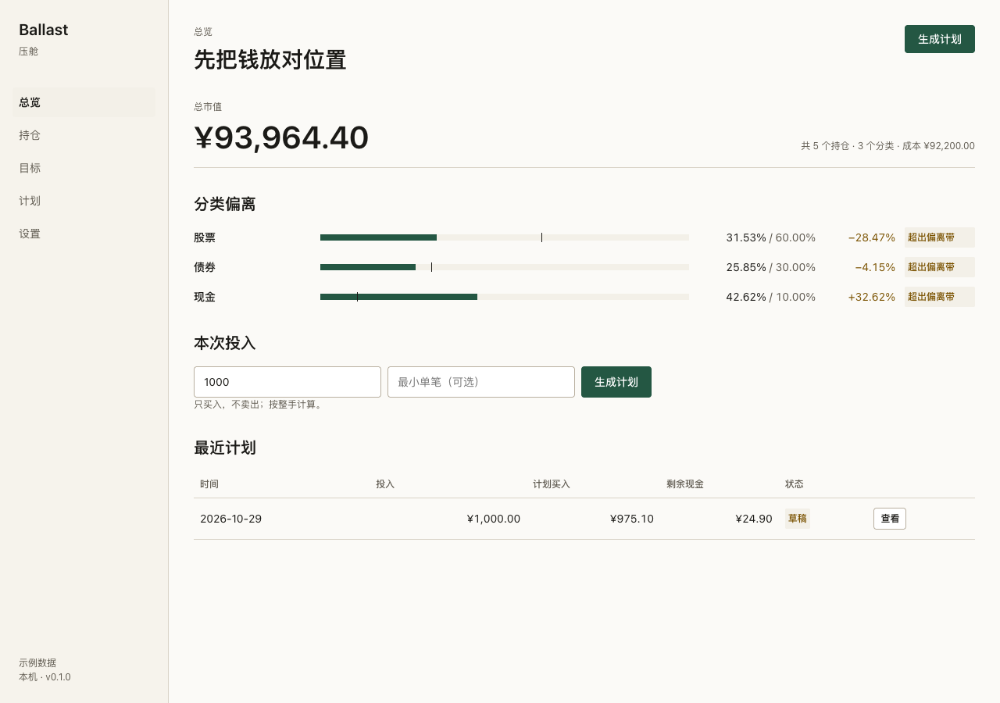

<p align="center"></p>

<h1 align="center">Ballast 压舱</h1>

<p align="center">有新增资金、不想卖出时，算出这次该买什么、买多少。</p>

<p align="center">
  =22.13">
  
  
</p>

<p align="center"><a href="README_EN.md">English</a> · 中文</p>



Ballast 是本地优先的**投入再平衡**工具。你每月有一笔新钱，不想卖旧仓，只想按目标比例把它买进去；Ballast 按整手算出一份买入计划，你确认后在某个账户执行，持仓和计划历史自动更新。

它不抓行情、不连券商、不自动下单、不建议卖出。所有数字都在本机 SQLite 里，没有账号、没有遥测、没有外部 API。

## 适用 / 不适用

**适用**

- 每月/每季度有固定新增资金，用 ETF 或股票做长期配置。
- 自己记账，愿意手动更新价格。
- 想要“只买不卖”的再平衡，避免卖出触发税费和情绪化操作。
- 在意数据留在本机、代码可审计。

**不适用**

- 想要自动同步券商、实时行情、自动交易。
- 需要卖出建议、税务批次、收益归因、多币种。
- 需要多用户、登录、云同步、手机 App。
- 想要“智能推荐买什么”；Ballast 只做算术，不判断该不该买。

## 已知限制

- 只支持整手买入；买不起一手时钱会留在现金里，并可能让买入后最大偏离变大（会显示 `drift_worsened` 警告）。
- 价格靠手动输入，过期只警告，不自动更新。
- CSV 导入不可撤销；导错用备份恢复，或补反向手工交易。
- 日期统一 UTC；不按浏览器时区换算。
- 0.1.0 没有卖出建议、税务、多币种、登录。

## 功能

- 组合、账户、分类目标与偏离带
- 代码、每手份数、价格与价格日期
- 手工买入/卖出、持仓、平均成本、未实现盈亏
- CSV 模板、导入、交易/持仓导出
- 只买不卖的 `greedy-v1` 计划、执行、计划历史
- 计划过期保护、执行幂等、警告、剩余现金
- 备份下载、示例模式、浅色/深色、375px

详见 [docs/features.md](docs/features.md)。

## 快速开始

### 本地

要求 Node.js >= 22.13.0。

```bash
npm ci
npm run build
npm start
# 打开 http://127.0.0.1:8787
```

### Docker

```bash
docker compose up -d --build
# 打开 http://127.0.0.1:8787
```

首次打开会进入设置页；选“三分类”模板后，到“持仓”页给每个目标大于 0 的分类各加一个代码，再“新增买入”。想先看示例：`BALLAST_DEMO=1 npm start`，或把 `docker-compose.yml` 里的 `BALLAST_DEMO` 改成 `"1"`。

## 命令

```bash
npm start            # 启动服务（默认 127.0.0.1:8787）
npm run dev          # 后端 watch
npm run build        # 构建前端到 web/dist
npm test             # node:test
npm run test:repeat  # 连续 3 次测试
npm run check        # 设计 + 离线资源检查
npm run screenshots  # 用本机 Chrome 生成截图
```

命令行参数：`ballast [--port <n>] [--data-dir <path>] [--help] [--version]`。

## 升级与备份

- 升级：拉取新代码，`npm ci && npm run build`，重启；数据库迁移会自动执行，迁移前备份到 `data/backups/`。
- 备份：设置页“下载备份”，得到单个 SQLite 文件。
- 恢复：停止服务，把备份命名为 `ballast.sqlite` 放进新的 `BALLAST_DATA_DIR`，启动。
- Docker 的备份/恢复见 [docs/deploy.md](docs/deploy.md)。

## 文档

- [功能](docs/features.md)
- [开发](docs/development.md)
- [部署](docs/deploy.md)
- [外部依赖](docs/external-apis.md)
- [与规格的偏差](docs/deviations.md)
- [选题过程](docs/选题.md)
- [设计规范](DESIGN.md)
- [规格](SPEC.md)
- [更新日志](CHANGELOG.md)

## 许可证

MIT。见 [LICENSE](LICENSE)。选择理由见 [notes/许可证.md](notes/许可证.md)。
